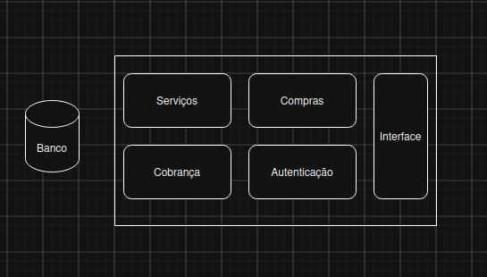
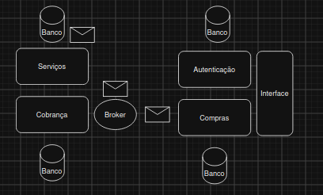

# Dual Write Problem

Sexta-feira. Depois de uma semana cansativa, você planejou viajar para para um pequeno paraíso no interior. Você tem duas horas até chegar à rodoviária. Todas sua bagagem está pronta. Você pede solicita uma corrida em um novo aplicativo de carona que seu colega te indicou, mas, após dez minutos nenhum motorista aceitou a corrida. Coincidentemente, seu amigo te liga e oferece uma carona e você cancela o pedido. O aplicativo mostra a efetivação do cancelamento mas você não recebeu o estorno do pagamento. Você vai se aborrecer no suporte ao cliente. 
Os desenvolvedores desse aplicativo imaginário não garantiram a consistência dos dados: o gerenciador de caronas cancelou seu pedido, mas o sistema responsável pelo estorno nunca ficou sabendo. Uma das possíveis causas é o `Dual Write Problem`, um conhecido desafio para garantia de consistência de dados no universo dos microsserviços. Para compreender esse conceito, vamos revisar a diferença entre sistemas monolíticos e microsserviços.

## Sistemas Monolíticos

Imagine uma aplicação que gerencia a venda de planos de internet que possui interface do usuário, um solução de autenticação, o sistema de cobranças, o registro das compras e o gerenciador das ordens de serviço. Esses subsistemas interagem entre si para garantir o pleno funcionamento do nosso sistema imaginário. Em um sistema monolítico, todos esses subsistemas vivem na mesma aplicação e compartilham o mesmo banco de dados.

Esse tipo de arquitetura tende a ser menos complexa, o que permite rápida entrega de valor. Contudo, tende a deixar a desejar quando o quesito é resiliência. Se houver um problema em qualquer dos módulos, toda a aplicação deixa de funcionar. Outro problema é que alto nível de `acoplamento` entre os subsistemas dificulta a escalabilidade: seu gargalo está no sistema de pagamentos, mas para escalá-lo você precisa escalar toda a aplicação.

Aplicações de pequeno porte, não críticas e que não possuem requisito de escalabilidade podem se beneficiar de sistemas monolíticos.

## Microsserviços

Se o mesmo sistema tivesse sido construído com uma arquitetura baseada em microsserviços, cada um dos módulos constitui uma aplicação especializada responsável por uma parte da solução; cada uma com seu próprio banco de dados dedicado. A arquitetura de microsserviços possui um nível de complexidade maior. No entanto, em sistemas críticos, grandes e que demandam escalabilidade esse trade off pode fazer sentido. Desde que o contrato de interface entre os microsserviços seja mantido, novas funcionalidades podem ser adicionadas e os serviços podem ser conteinerizados e escalados de forma granular.

### Comunicação Síncrona

Na comunicação síncrona, um serviço A envia uma requisição diretamente a um serviço B, que processa a requisição e retorna uma resposta ao serviço A. No nosso exemplo, quando o usuário for se autenticar no sistema, a interface gráfica poderia enviar as credenciais do usuário via `requisição http` para o sistema responsável pela autenticação. Este último faz todas as validações necessárias e devolve um `resposta http` reportando o sucesso ou a falha na autenticação.
Perceba que o serviço que requisita precisa esperar a resposta do serviço requisitado. Se o serviço requisitado estiver fora do ar, a requisição não poderá ser processada. 

### Comunicação Assíncrona

Em contraste, na comunicação assíncrona, o serviço requisitante não precisa conhecer os serviços que processam os dados. Utilizando o padrão publisher/subscriber, um serviço A publica uma mensagem em um [message broker](https://devskin.com/post/message-broker-comparativo-tcnico-entre-kafka-rabbitmq-e-sqs) (como kafka, aws sqs/sns, RabbitMQ, etc) e os serviços B, C - ou o próprio serviço A - consomem a mensagem e executa o processamento necessário.
Nesse cenário, se uma mensagem for publicada no broker enquanto algum serviço consumidor estiver fora do ar, o processamento poderá ocorrer quando o serviço voltar a funcionar. Isso traz maior resiliência ao sistema.
Em nosso sistema, o serviço de compras pode estar configurado para validar o pedido, salvar a compra no banco de dados e publicar uma mensagem em um tópico kafka `internet-plan-sold-topic`. A aplicação responsável pelas ordens de serviço consome esse tópico e cria uma nova requisição com status pendente para o time operacional realizar a instalação da internet do cliente que efetuou a compra.
A comunicação assíncrona traz a complexidade de implementar message broker, lidar com a risco de perdas de mensagens, mensagens duplicadas, entre outros.

## Dual Write Problem

Mas o que acontece quando o serviço de compras salva no seu banco de dados a requisição mas a publicação no message broker falha? Exatamente. Os dados ficam inconsistentes. No nosso exemplo, a compra será registrada mas o time responsável por instalar a internet para o cliente não receberá a ordem de serviço. Casos recorrentes elevam os custos com suporte ao cliente e podem culminar em crise de reputação para o negócio. 
O problema de dual write ocorre porque não é possível implementar um fluxo que salve a mesma informação em dois sistemas diferentes de forma atômica: não tem como apagar o registro da compra do banco de dados porque a publicação no message broker falhou. Também não há como desfazer a publicação no message broker caso a escrita no banco de dados falhe. Felizmente, existem algumas formas de mitigar esse problema.

### Outbox Pattern

No padrão outbox, o serviço persiste os dados em seu banco de dados e, paralelamente, salva a mensagem que será publicada em uma tabela separada, chamada de outbox. Um processo separado detecta novos registros na tabela outbox, recupera os dados da mensagem e a publica no message broker. Isso garante que a consistência dos dados mesmo que o broker esteja fora do ar, pois, assim que voltar a funcionar, as mensagens voltarão a ser publicadas e consumidas.
Se, por alguma razão, a mensagem publicada for perdida no message broker, é possível acessar a tabela outbox e republicar a mensagem. Isso implica que esse padrão garante a publicação da mensagem pelo menos uma vez. Por isso é preciso garantir a idempotencia do lado dos serviços que consomem as mensagens.

### Event Sourcing

Consiste em persistir os eventos e não o estado atual de determinada entidade. Confuso? Imagine que no nosso exemplo, a aplicação que gera a ordem de serviço é responsável também por seu ciclo de vida:
* o consumo do tópico `internet-plan-sold-topic` gera uma ordem de serviço com status `PENDING`
* Quando atribuída a um colaborador, o status passa a ser `EXECUTING`
* Quando a internet é disponibilizada para o cliente, o status passa a ser `FINISHED`.

Poderíamos persistir no banco de dados a ordem de serviços com status `PENDING` e apenas atualizarmos o status do registro quando necessário. Em Event Sourcing, salvamos todos os eventos e ao final do ciclo de vida da ordem de serviço teremos três registros no banco, um para cada status. Um outro processo publica as mensagens no message broker posteriormente.

Isso permite que guardar detalhes de cada evento, mas exige calcular o status atual com base nos eventos salvos. Bancos são um bom exemplo de caso de uso para Event Sourcing.

### Listen to Yourself

Uma outra estratégia que garante a consistência dos dados consiste em o serviço receber o comando e publicá-lo diretamente no message broker. Posteriormente, um listener configurado no mesmo serviço consome a mensagem publicada e salva no banco de dados. Isso é particularmente útil quando temos um processo que requer muitas operações de leitura e escrita no banco de dados ou que executa um algoritmo complexo que o cliente não precisa esperar pela resposta. Essa estratégia ajuda a reduzir a latência sem abrir mão da consistência dos dados. 

É preciso garantir que o conteúdo da mensagem publicada no message broker seja compatível com o schema do banco de dados para que a estratégia funcione. 

Um problema potencial é que os serviços consumidores podem finalizar o processamento da mensagem mais rápido que o serviço produtor, gerando uma inconsistência temporária. Nessa janela, uma chamada http de um serviço downstream pode não encontrar os registros em processamento. Isso significa que esta solução garante *consistência eventual*: Quando os dados forem persistidos no produtor, consistência é restabelecida. 

#### Qual escolher?

A solução depende da situação concreta que que se pretende resolver. O padrão outbox traz a complexidade de manter duas tabelas. Event Sourcing te obriga a calcular o estado atual a partir do último evento. No padrão listen to yourself, existe o risco de serviços consumidores obtenham a informação antes mesmo que o serviço que publicou a mensagem. Se quiser saber mais sobre esse tema e outros conteúdos relacionados à event-driven design, recomendo esse material da [confluent](https://developer.confluent.io/courses/microservices/overview/), que inspirou esse artigo.